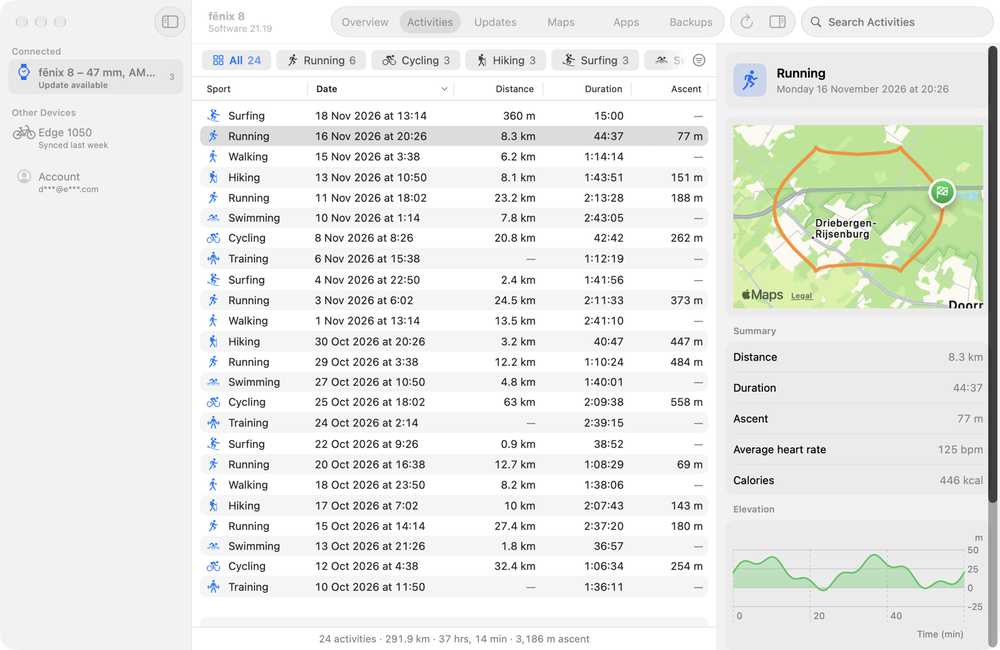
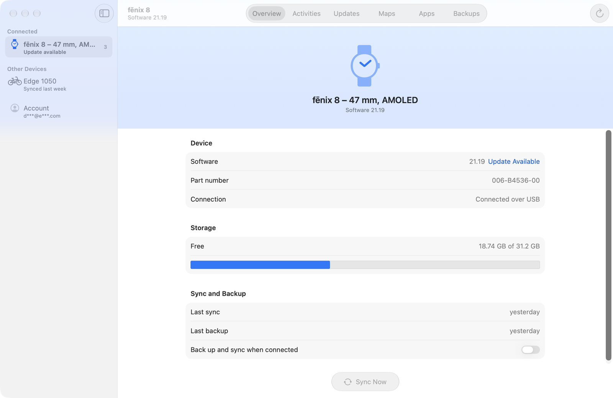
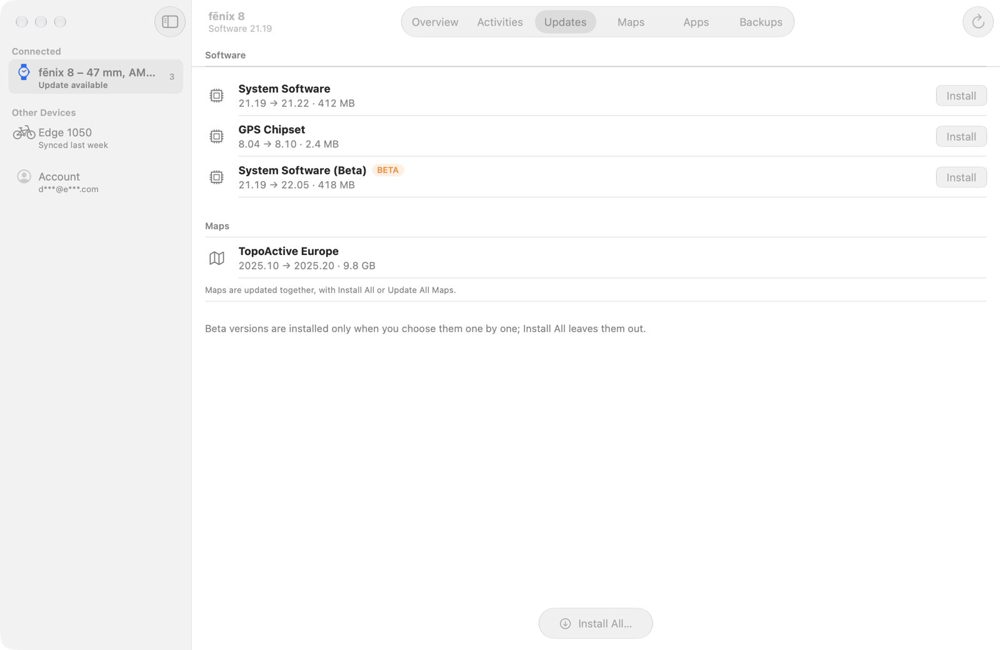
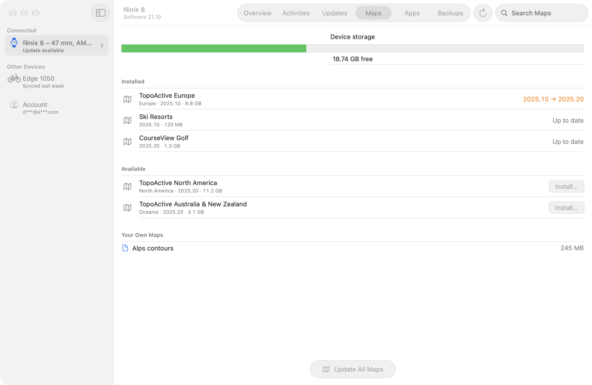
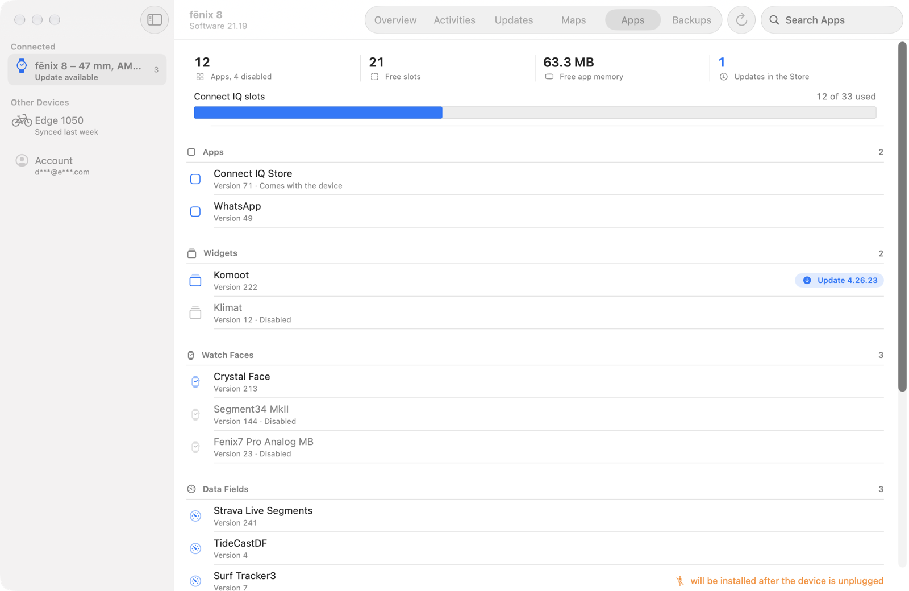

  

<h1 align="center">openExpress for Mac</h1>

  A native Mac app for Garmin watches and bike computers: sync with Garmin Connect, backups,
  activities, software updates, maps and Connect IQ apps over USB.

  
  
  

  <picture>
    <source media="(prefers-color-scheme: dark)" srcset="docs/screenshots/mac/activities.png">
    
  </picture>

openExpress for Mac is the macOS edition of
[openExpress](https://github.com/TomaszBojanowski/openExpress) by Tomasz Bojanowski. It is a
SwiftUI app for Apple silicon Macs, built on openExpress's engine, and does what you would use
Garmin Express for – as free software without telemetry, with backups of your device on your
Mac, your activities with their maps and charts, and a command line beside the app.

> **Not affiliated with, endorsed by or supported by Garmin Ltd.**
> Garmin, fēnix, Edge, Garmin Connect, Garmin Express and Connect IQ are trademarks of Garmin
> Ltd. or its subsidiaries. openExpress talks to the same Garmin services as the official app;
> Garmin may change them at any time. Use at your own risk.

## What it does

- **Sync with Garmin Connect.** New activities and other data on the device are uploaded;
  what Garmin Connect has queued for the device (workouts, courses and other files) is
  written to it. The first sync asks whether to upload everything still on
  the device or only what it records from now on; activities Garmin Connect already has are
  recognised.
- **Backups on your Mac.** A copy of the device's files in a folder you choose, keeping the
  newest backups you ask for. Backups are incremental: a file unchanged since the previous
  backup is linked rather than copied again, so several backups cost little extra space.
- **Activities.** The activities on the device, filtered by sport, date, distance and
  duration, with distance, duration, ascent, average heart rate and calories.
  Each has its route on a map and elevation and heart-rate charts.
- **Software updates** for the device, including beta versions it is offered (installed only
  when you choose them one by one). An update is copied to the device, which installs it once
  you unplug it. Nothing is ever installed without asking.
- **Maps.** Install, update and remove Garmin's free maps for the device; maps of your own on
  it are listed.
- **Connect IQ apps.** The apps, watch faces and data fields on the device by kind, its free
  slots and memory, available updates, and the apps on your Garmin account that are not on the
  device.
- **Garmin Connect readings.** On a device's Overview, the batteries of the sensors on your
  account (low ones first) and, for a watch that charges from the sun, the activity time the
  sun gained it today and in the last 7 days.
- **In the background.** A menu bar item, notifications, and (optional) an automatic backup
  and sync whenever a device is connected. Software and map updates are only checked
  automatically, never installed.
- **FIT drop folder** (optional): after each sync, new activity files are copied to a folder of
  your choice for other apps to pick up.
- **Strava** (optional): upload new activities after each sync with your own Strava API
  application. Leave it off if Garmin Connect already sends your activities to Strava.
- **Keeps the Mac awake** while it works with the device, so a long backup or map install is
  not cut off by idle sleep.

Garmin Express must not be running: it holds the device while it runs. openExpress for Mac
says so when it finds the device in use, and never quits other apps for you.

## Screenshots

<table>
  <tr>
    <td width="50%">
      <picture>
        <source media="(prefers-color-scheme: dark)" srcset="docs/screenshots/mac/overview.png">
        
      </picture>
      
<b>Overview</b> – software, storage, sync and backup at a glance

    </td>
    <td width="50%">
      <picture>
        <source media="(prefers-color-scheme: dark)" srcset="docs/screenshots/mac/updates.png">
        
      </picture>
      
<b>Updates</b> – software for the device, betas included

    </td>
  </tr>
  <tr>
    <td width="50%">
      <picture>
        <source media="(prefers-color-scheme: dark)" srcset="docs/screenshots/mac/maps.png">
        
      </picture>
      
<b>Maps</b> – install, update and remove Garmin's maps

    </td>
    <td width="50%">
      <picture>
        <source media="(prefers-color-scheme: dark)" srcset="docs/screenshots/mac/apps.png">
        
      </picture>
      
<b>Apps</b> – the Connect IQ apps on the device

    </td>
  </tr>
</table>

## Download and install

**[Download the latest release](https://github.com/bruring/openExpress-mac/releases/latest)**
– `openExpress-for-Mac-<version>.pkg`.

Requirements: a Mac with **Apple silicon** and **macOS 26** or later. Nothing else to install:
the package carries its own engine (with its own Python). The package is signed and notarized
by Apple, so it opens without warnings, and installs `openExpress for Mac.app` into
`/Applications`.

First steps:

1. **Quit Garmin Express**, from its menu bar icon, so that Garmin Express Service stops too.
2. **Open openExpress for Mac** and set it up. openExpress needs the application key inside
   Garmin Express for Windows: the app can download that installer from Garmin, read the key
   from it and delete it again (or you choose a `GarminExpress.exe` you already have). Nothing
   of it is installed.
3. **Sign in** to Garmin Connect on Garmin's own sign-in page. Your password is typed only
   there.
4. **Connect the device** with its USB cable and unlock it if it asks. It appears in the
   sidebar.
5. **Sync.** The first sync asks whether to upload everything on the device or new data only.
   To back up and sync whenever the device is connected, turn on **Back up and sync when
   connected**.

## Privacy

- No telemetry.
- Your password is typed only on Garmin's sign-in page. The sign-in token, the application key
  and any Strava tokens are kept in the macOS Keychain.
- Device data goes to Garmin's servers only. Strava is contacted only if you connect it, and
  only for the activities a sync uploads. Activity routes are drawn on Apple Maps.
- Nothing is uploaded unless your Garmin account has given its consent to upload device data;
  a sync never deletes files from the device, and every file written to it is checked.
- Settings, backups and data stay on your Mac, in `~/Library/Application Support/openExpress`
  (and the backup folder you choose).

In full: [Privacy and security](docs/privacy.md).

## Supported devices

Tested with openExpress for Mac: **fēnix 8**, **Edge 1040** and **Venu 2S** over MTP, and
**Edge 820** as a USB drive. Other Garmin watches and bike computers that connect over USB as a
media device (MTP) should work too; openExpress (Linux) lists the devices it was tested with in
[Supported devices](docs/devices.md).

Devices that connect as a USB drive (mass storage, e.g. older Edge software, handhelds or car
navigators) work too: macOS mounts them, openExpress uses them as on Linux and ejects them after
a sync, so the device takes the new files. Tested on an Edge 820: its files, activities,
backup and a software update; please report how your Garmin drive does.

Not supported yet: devices that keep their music on a separate storage (e.g. Forerunner 645
Music); see [Supported devices](docs/devices.md).

Please report what works and what does not on your device in the
[issues](https://github.com/bruring/openExpress-mac/issues).

## openExpress for Mac and openExpress

openExpress for Mac is built on [openExpress](https://github.com/TomaszBojanowski/openExpress)
by Tomasz Bojanowski, an unofficial Linux app for Garmin devices
([openexpress.bojanowski.me](https://openexpress.bojanowski.me)). openExpress's Python code is
the engine; this edition adds a macOS device layer (its own MTP client over libusb), the
SwiftUI app and the installer. The name is used with the agreement of openExpress's maintainer.

- For Linux, use [openExpress](https://github.com/TomaszBojanowski/openExpress) itself.
- Fixes and features that are not Mac-specific go upstream, to openExpress.
- Both are free software under the [GNU General Public License v3.0 or later](LICENSE).

## For developers

- [openExpress for Mac](docs/macos.md) – how it fits together, building the app, the engine
  and the package, signing, tests
- [The engine protocol](docs/ENGINE.md) – JSON Lines between the app and `openexpress engine`
- [Contributing](CONTRIBUTING.md) and [Translating](docs/translating.md)
- [Usage](docs/guide.md) and [Command line](docs/cli.md) – openExpress's own documentation; the
  engine's command line works on the Mac too
